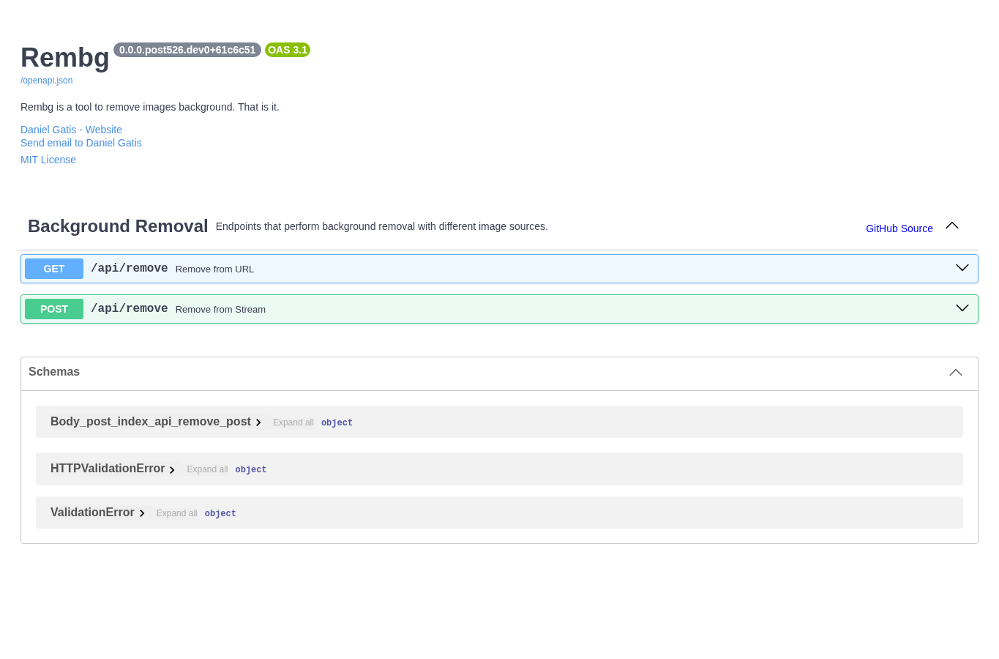
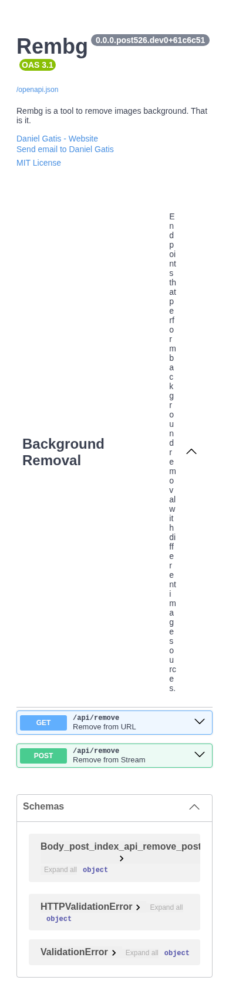
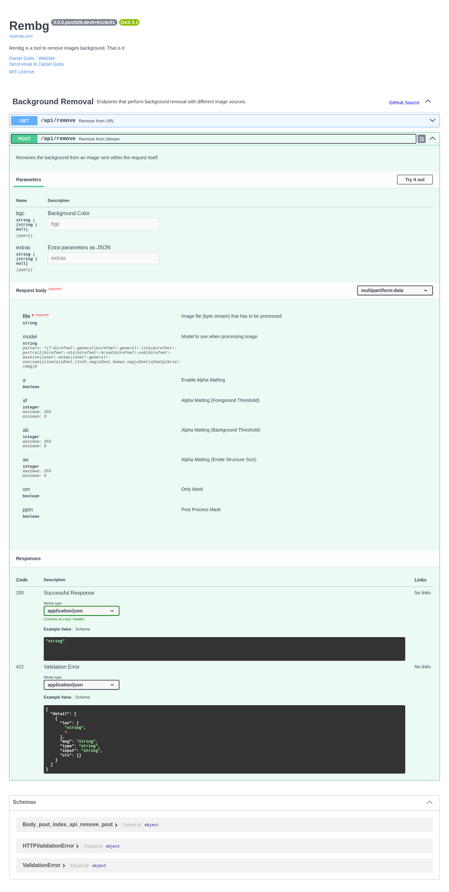
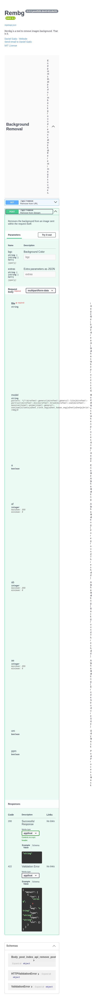

# Documentación HTTP · Swagger

Ruta o vista: `/api`. Fuente `59c892db84777afda2bac85f9d44cb2454b8ec4f`. Captura original aislada; fecha y hashes de fuente en [recibo](../browser-receipt.json), hashes de imágenes en [manifest](../manifest.json).

Documentación generada por la app original: metadatos, dos operaciones de eliminación de fondo, parámetros y respuestas.

| Sección / componentes | Definición y funciones (rango inclusivo) | Estilos / efectos |
|---|---|---|
| Metadatos y navegación API | rembg/commands/s_command.py:92–107 · FastAPI(title,version,contact,license,docs_url) | Swagger UI JS5.33.2/CSS5.33.0 originales del alias @5 usado por FastAPI; rutas/hash ../browser-receipt.json y ../source-map.json. |
| Parámetros GET/POST | rembg/commands/s_command.py:117–203 · CommonQueryParams / CommonQueryPostParams | Formularios/esquemas generados por FastAPI; render de Swagger original, sin CSS propio. |
| Operaciones /api/remove | rembg/commands/s_command.py:205–220 · im_without_bg; GET238–251; POST253–266 | Expansión de POST capturada. No se presionó Execute ni se envió URL/archivo. |
| Schemas / respuestas | rembg/commands/s_command.py:245–248,259–266 y modelos FastAPI derivados | Responses y Schemas originales de la dependencia; no resultados fabricados. |

## Imágenes y estados

### default · desktop

La imagen muestra SwaggerUi. Resolución de navegador 1365×900; captura de la página completa, tema solicitado light.

### default · mobile

La imagen muestra SwaggerUi. Resolución de navegador 390×844; captura de la página completa, tema solicitado light.

### post-expanded · desktop

La imagen muestra SwaggerUi, OperationDetails, Parameters, Responses. Resolución de navegador 1365×900; captura de la página completa, tema solicitado light.

### post-expanded · mobile

La imagen muestra SwaggerUi, OperationDetails, Parameters, Responses. Resolución de navegador 390×844; captura de la página completa, tema solicitado light.

**Hallazgo:** el documento ocupa 563 px y excede el viewport de 390 px. No se alteró CSS para ocultarlo.

## Verificación y límites

Assets CDN públicos preparados sin credenciales y servidos con los mismos bytes dentro del namespace; ninguna petición de la captura salió a internet. El texto descriptivo de la etiqueta se comprime verticalmente en móvil390px: hallazgo visual P2 del layout Swagger actual, CSS preservado. Favicon remoto bloqueado. Los nombres/versiones que aparecen son los de los paquetes instalados; el commit de fuente está en el recibo, no se infiere del __version__.
