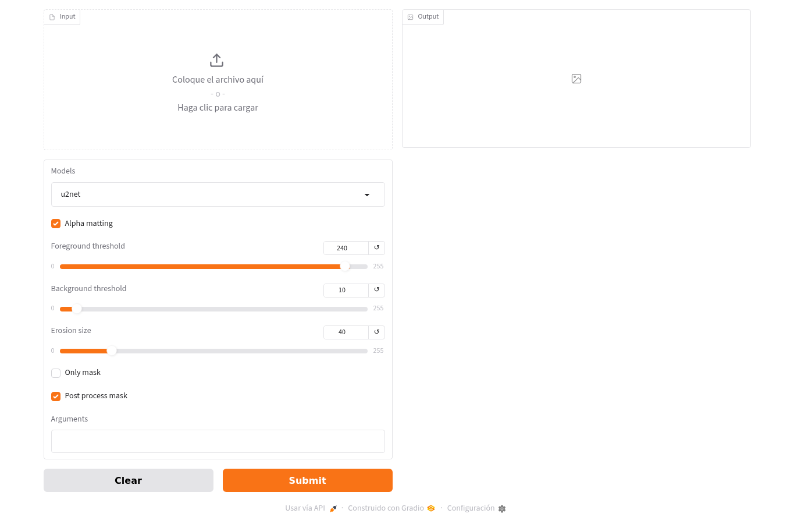
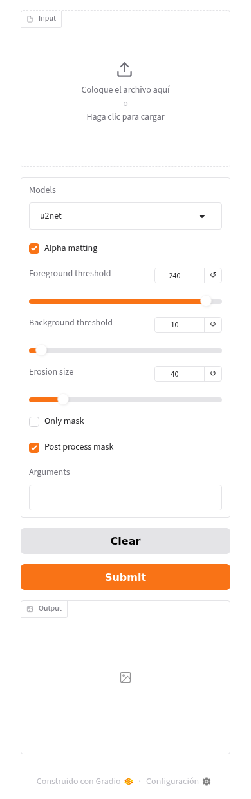
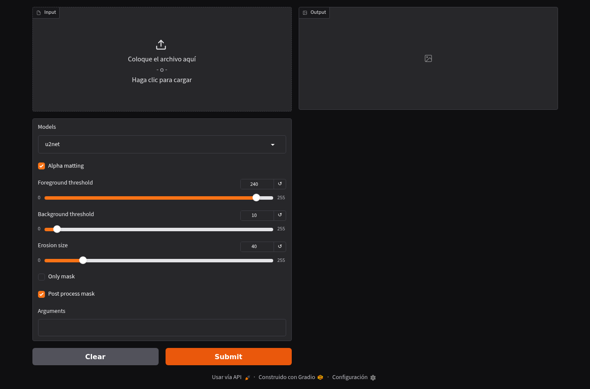
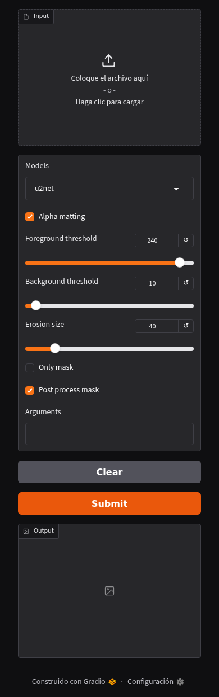
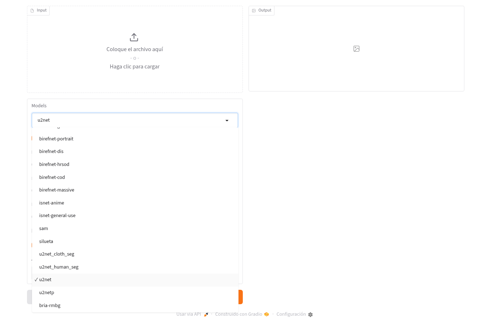
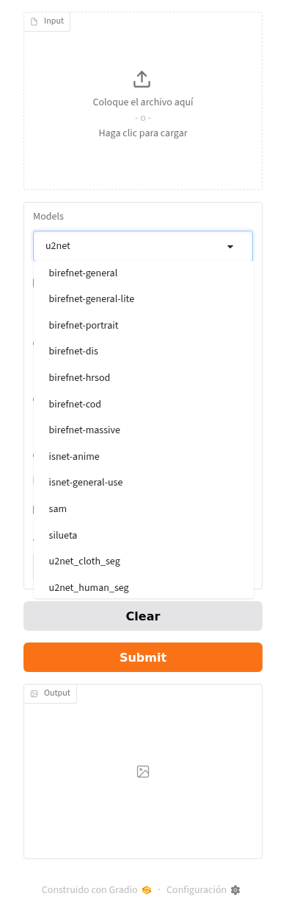

# Eliminar fondo · interfaz Gradio

Ruta o vista: `/`. Fuente `59c892db84777afda2bac85f9d44cb2454b8ec4f`. Captura original aislada; fecha y hashes de fuente en [recibo](../browser-receipt.json), hashes de imágenes en [manifest](../manifest.json).

Formulario real del fork: archivo, modelo, recorte, máscaras y salida. Capturas con todos los controles cargados; la interfaz puede traducir controles de Gradio al español aunque los labels propios estén en inglés.

Mapa funcional previo: [../../pages/interface.md](../../pages/interface.md); esta ficha añade la evidencia visual y no lo reemplaza.

| Sección / componentes | Definición y funciones (rango inclusivo) | Estilos / efectos |
|---|---|---|
| Servidor y modelos disponibles | rembg/commands/s_command.py:77–329 · create_server_app; filtro79–81; construcción292–327 | Gradio6.29.1; tema predeterminado y estados claro/oscuro del componente. CSS vendorizado con rutas/hash en ../source-map.json, sin CSS de marca propio. |
| Entrada de imagen / Input | rembg/commands/s_command.py:295–297; UploadOnlyInterface rembg/server_ui.py:12–44; preprocess_data20–44 | File, zona de drop, label, borde y uploader generados por Gradio. |
| Models / selección | rembg/commands/s_command.py:298; rembg/sessions/__init__.py: nombres permitidos | Dropdown, lista y valor seleccionado; panel abierto capturado sin inferencia. |
| Opciones de recorte | rembg/commands/s_command.py:299–308 · Alpha matting / Foreground threshold / Background threshold / Erosion size | Checkbox y Slider Gradio; valores240/10/40 de la interfaz. |
| Máscara / postproceso / Arguments | rembg/commands/s_command.py:309–311 | Checkbox, Textbox; edición no exige IA hasta Submit. |
| Output y acciones | rembg/commands/s_command.py:269–288 · inference; Image313; cola321–326 | Imagen de salida vacía, Clear/Submit/footer de Gradio. La imagen recortada no se simuló. |
| Límites y procesamiento | rembg/server_processing.py · ImageProcessor; funciones y clases en ../source-map.json; rembg/server_security.py · RequestSizeLimit | Una inferencia activa, cola4, cache60/3600 y límite MAX_IMAGE_BYTES; captura no acredita inferencia real. |

## Imágenes y estados

### default · desktop

La imagen muestra UploadOnlyInterface, FileInput, ModelsDropdown, AlphaMatting, Thresholds, MaskControls, Arguments, OutputImage, SubmitQueue. Resolución de navegador 1365×900; captura de la página completa, tema solicitado light.

### default · mobile

La imagen muestra UploadOnlyInterface, FileInput, ModelsDropdown, AlphaMatting, Thresholds, MaskControls, Arguments, OutputImage, SubmitQueue. Resolución de navegador 390×844; captura de la página completa, tema solicitado light.

### dark · desktop

La imagen muestra UploadOnlyInterface, FileInput, ModelsDropdown, AlphaMatting, Thresholds, MaskControls, Arguments, OutputImage, SubmitQueue. Resolución de navegador 1365×900; captura de la página completa, tema solicitado dark.

### dark · mobile

La imagen muestra UploadOnlyInterface, FileInput, ModelsDropdown, AlphaMatting, Thresholds, MaskControls, Arguments, OutputImage, SubmitQueue. Resolución de navegador 390×844; captura de la página completa, tema solicitado dark.

### models-open · desktop

La imagen muestra FileInput, ModelsDropdown abierto y OutputImage vacío. El menú de modelos oculta AlphaMatting, Thresholds, MaskControls y Arguments, y cubre parte de las acciones Clear/Submit. Resolución de navegador 1365×900; captura de la página completa, tema solicitado light.

### models-open · mobile

La imagen muestra FileInput, ModelsDropdown abierto y OutputImage vacío. El menú de modelos oculta AlphaMatting, Thresholds, MaskControls y Arguments; las acciones Clear y Submit quedan visibles debajo del menú. Resolución de navegador 390×844; captura de la página completa, tema solicitado light.

## Verificación y límites

Se esperó explícitamente cada label propio y la finalización de recursos locales. Capturados claro/oscuro y selector Models abierto, en ambos tamaños. Sin upload, inferencia, pesos descargados ni imágenes privadas. El ajuste NUMBA_DISABLE_JIT sólo acorta el arranque del ensayo visual, no representa rendimiento de producción. [Mapa de funciones y estilos de dependencia](../source-map.json).
